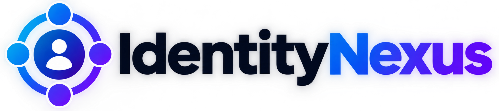
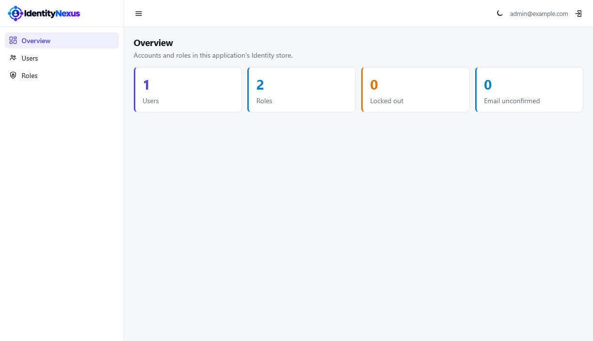
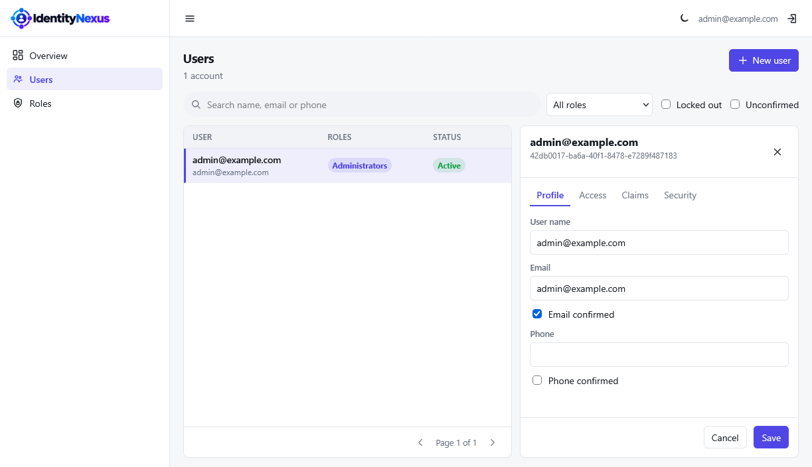
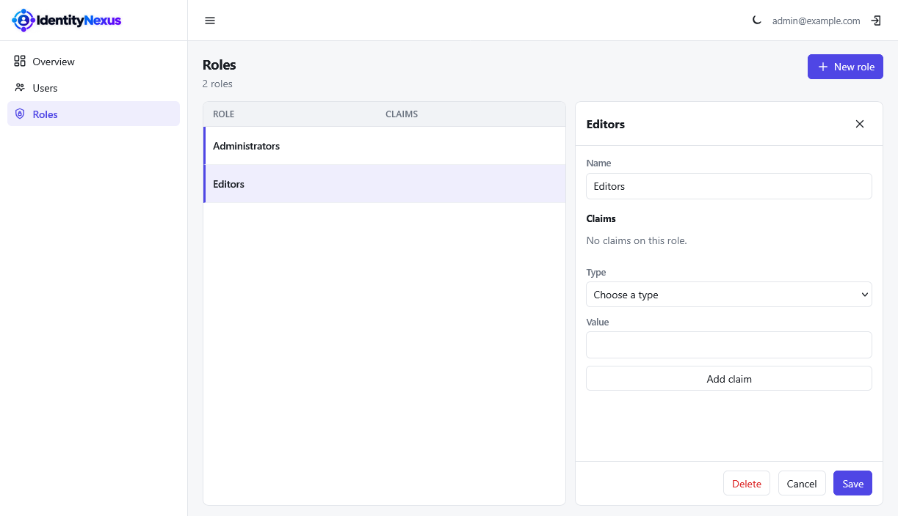

A Blazor management UI for the ASP.NET Core Identity users and roles an application already has.
Drop it into any site that uses Identity with an Entity Framework store.

IdentityNexus does not create its own user tables and does not replace `UserManager` or `RoleManager`.

Users and roles use string keys. Passwords, security stamps, lockout and role assignment all go through the host's Identity managers, so the host's password rules and token providers stay in force.

## Screenshots







## What you can do

- Search and page users, and filter by role, lockout or an unconfirmed email.
- Create and edit users, including email, phone, confirmation flags and two-factor.
- Assign roles, edit claims, set a password, remove an external login, reset an authenticator, and delete a user.
- Create, rename and delete roles, including role claims.
- The signed-in account cannot delete itself or lock itself out.
- Add your own tabs to the user and role editors, and hear about every change (see [Extending the editors](#extending-the-editors)).

## Add it to an existing site

The host registers Identity first, against whichever database it already uses. SQLite, SQL Server,
PostgreSQL and MySQL all work, because queries go through the host's Entity Framework store.

```csharp
builder.Services
    .AddIdentity<ApplicationUser, ApplicationRole>()
    .AddEntityFrameworkStores<ApplicationDbContext>()
    .AddDefaultTokenProviders();

builder.Services.AddIdentityNexus<ApplicationUser, ApplicationRole>(options =>
{
    options.HomePath = "/";
    options.LogoutPath = "/account/logout";
});

var app = builder.Build();

app.UseAuthentication();
app.UseAuthorization();

app.MapIdentityNexus().RequireAuthorization();
```

`ApplicationUser` must derive from `IdentityUser`, and `ApplicationRole` from `IdentityRole`, with a
public parameterless constructor. Browse to `/identity`.

`Title` is the browser tab title. The header logo and name come from the host's `ForgeShellOptions` (`LogoUrl`, `LogoDarkUrl`, `MarkUrl`, `Brand`), the same branding as the rest of the site. With none set, the built-in logo is shown.

`HomePath` adds a top-bar link back to the host site. `LogoutPath` adds the sign-out button. Set either, both, or neither. A relative home path is rooted so the UI's `<base href>` does not keep the link inside `/identity`.

## Tenants

A host that stores a tenant id on its user or role type can scope the UI to the current tenant. Call either method, or both. The selector is the property on the Identity type. The callback runs on each query, including inside the Blazor circuit, and returns `TenantKey<TKey>.None` when this request has no tenant. A value limits lists and lookups to that tenant and is written onto users or roles that IdentityNexus creates. An id from another tenant is treated as missing.

`TenantKey.OfNullable` accepts an `int?`, `Guid?`, or any other nullable value type. A reference-type id uses `TenantKey<string>.Of(id)` and `TenantKey<string>.None`.

```csharp
builder.Services.ScopeUsersToTenant<ApplicationUser, int?>(
    user => user.TenantId,
    services => TenantKey.OfNullable(services.GetRequiredService<AppTenant>().Id));

builder.Services.ScopeRolesToTenant<ApplicationRole, int?>(
    role => role.TenantId,
    services => TenantKey.OfNullable(services.GetRequiredService<AppTenant>().Id));
```

`MapIdentityNexus()` returns the route group, so secure it the same way as any other endpoint:

```csharp
app.MapIdentityNexus().RequireAuthorization("Administrators");
```

The UI is a separate Blazor circuit mounted at the base path. It uses the NetForge shell and the
host's `ForgeUiOptions.ThemeStorageKey`, so a theme change here follows the rest of the site.
`IdentityNexusOptions.Area` pins that theme when the UI is the back office (for example `Admin`)
even though it is mounted at `/identity` rather than `/Admin`. Leave `Area` unset to share the
public theme. Call `UseAuthentication` and `UseAuthorization` before `MapIdentityNexus`.
A host with no `.razor` files of its own still receives `blazor.web.js` when IdentityNexus is
installed as a package. A project reference should import `build/IdentityNexus.props`, which the
demo does.

## Extending the editors

A host often keeps more on a user or role than Identity's own columns: a department, a set of
permissions, a profile in another table. IdentityNexus has three hooks for that, and none of them
assume anything about what the host stores.

### Sections

A section is a Blazor component that gets its own tab in the user or role editor. Derive from
`IdentityNexusSection`, load whatever you need from `Subject`, and save in `SaveAsync`:

```razor
@using Ardalis.Result
@using IdentityNexus.Extensibility
@inherits IdentityNexusSection

<label class="nx-field">
    <span>Department</span>
    <select class="nf-input" @bind="department">
        <option value="">None</option>
        <option>Sales</option>
        <option>Support</option>
    </select>
</label>

@code {
    private string department = string.Empty;

    protected override async Task OnInitializedAsync()
    {
        if (!Subject.IsNew)
        {
            department = await LoadDepartmentAsync(Subject.Kind, Subject.Id!);
        }
    }

    public override async Task<Result> SaveAsync(string id, CancellationToken cancellationToken = default)
    {
        await SaveDepartmentAsync(Subject.Kind, id, department);
        return Result.Success();
    }
}
```

`IdentityNexus.Demo/Sections/DepartmentSection.razor` is a complete version that stores the
department as a claim on users and roles.

Register it with a tab title:

```csharp
builder.Services.AddIdentityNexus<ApplicationUser, ApplicationRole>(options =>
{
    options.AddUserSection<DepartmentSection>("Department", "department");
    options.AddRoleSection<DepartmentSection>("Department", "department");
});
```

- `Subject` says whether the editor is showing a user or a role, its id and its name. For a new user or role, `IsNew` is true and the id is null.
- `SaveAsync` runs after the core editor has saved, so a new user or role already has its id. A failed `Result` is shown in the editor under the section's title. It does not undo the core save.
- Sections stay rendered while another tab is open, so unsaved input survives switching tabs.

### Managed claim types

Any arguments after the title are claim types that the section owns. Use this when a section stores
its data as claims. The editor's generic Claims list does not show these types, and saving that list
leaves them alone, so the two editors can't overwrite each other. You can also add types directly
with `options.ManagedClaimTypes.Add("department")`.

### Change observers

Implement `IIdentityChangeObserver` to hear about every user or role that IdentityNexus creates,
updates or deletes, for example to clear a cache or write an audit entry:

```csharp
public sealed class AuditObserver(ILogger<AuditObserver> logger) : IIdentityChangeObserver
{
    public Task OnChangedAsync(IdentityChange change, CancellationToken cancellationToken)
    {
        logger.LogInformation("{Kind} {Id} was {Type}", change.Kind, change.Id, change.Type);
        return Task.CompletedTask;
    }
}

builder.Services.AddIdentityNexusObserver<AuditObserver>();
```

Observers run after the change is saved. One that throws is logged, and the change still succeeds.

## Demo

`IdentityNexus.Demo` is a small host that signs in with a cookie and serves the UI. Set
`Database:Provider` to `Sqlite`, `SqlServer`, `Npgsql` or `MySql`, and set
`ConnectionStrings:IdentityNexus` for anything other than the default SQLite file.

The seeded account is `admin@example.com` / `Password1!`.

## Support

If you find this project useful, consider supporting its development.

<p align="center">
  <a href="https://buymeacoffee.com/vnmatt">
    
  </a>&nbsp;&nbsp;&nbsp;
  <a href="https://www.paypal.com/cgi-bin/webscr?cmd=_donations&business=gordon_matt%40live%2ecom&lc=AU&currency_code=AUD&bn=PP%2dDonationsBF%3abtn_donateCC_LG%2egif%3aNonHosted">
    
  </a>
</p>

<p align="center">
  Prefer using your phone? Scan the QR code:
</p>

<p align="center">
  <a href="https://buymeacoffee.com/vnmatt">
    
  </a>
</p>

